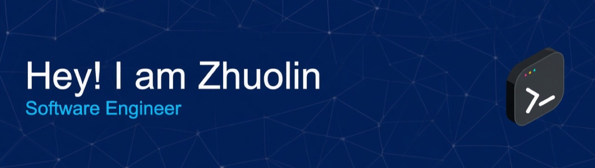

# Hi, I'm Zhuolin Li

CS student at CUNY City College of New York. I interned at AT&T on ML for network anomaly detection, built GenAI agent workflows in research, and shipped fullstack payment features in industry. I like working across backend and ML, especially tools with a clear real world use.

CodePath Technical Fellow · ACM City College Treasurer

## GitHub Activity

  
  

  

## Skills

**Languages**

**Technologies**

**ML & AI**

**Tools & concepts**

